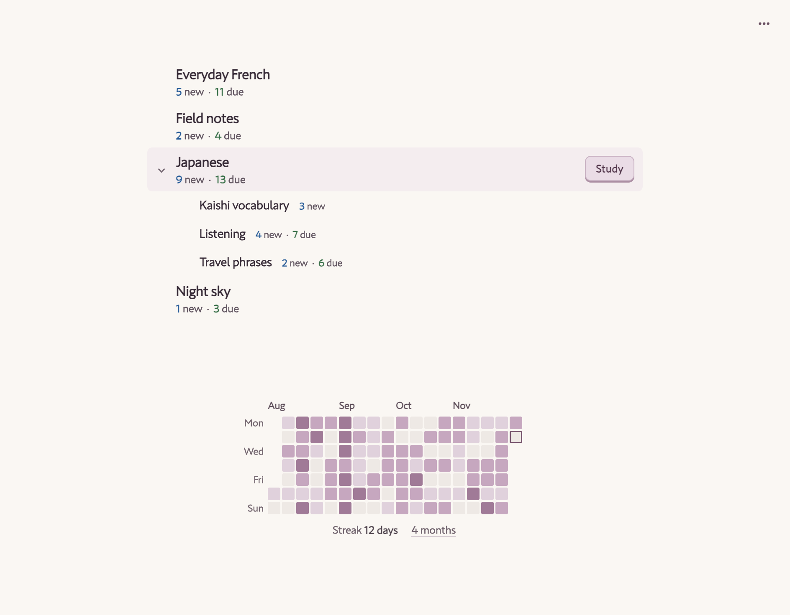
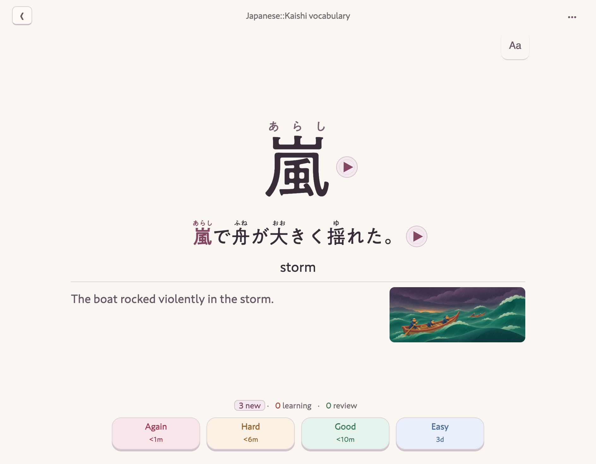
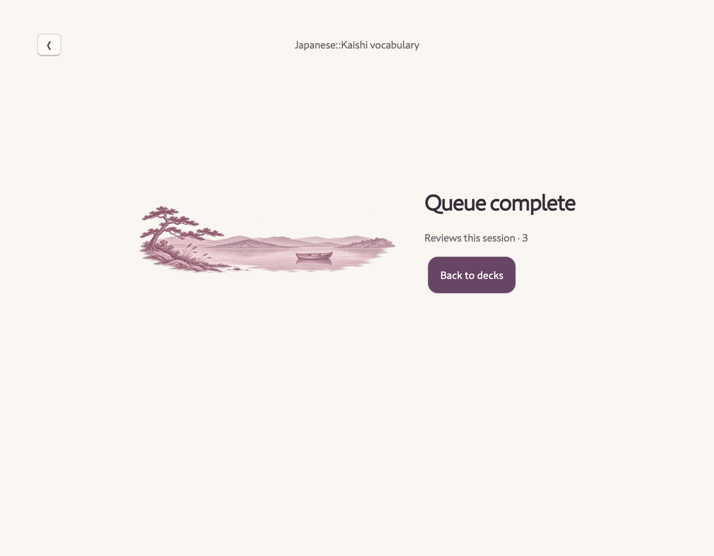

# Perapiko

Perapiko gives your Anki decks a calmer place to live. Pick a deck, see what’s due, and settle in for a review. When you’re done, a little seaside scene is waiting for you.

## Settle in

Expand a group, pick a deck, and press **Study**. The calendar below your decks keeps track of review activity across your collection. Hover over a day to see its count. Right-click a deck for its actions, including commands from compatible add-ons.

During a review, the highlighted counter tells you which queue your card came from. Press **Space** to show the answer and **1–4** to grade it. Anki takes care of scheduling and audio.

## Install

In Anki Desktop, open **Tools → Add-ons → Install from file**, choose **Perapiko.ankiaddon**, and restart Anki. The interface uses your system font. If you have another favorite installed, choose it under **Tools → Add-ons → Perapiko → Config**. Your card templates control their own fonts and colors.

## A little extra for Japanese learners

The optional **Perapiko-Kaishi.zip** includes a reading template for Kaishi. See how much you remember from the word alone, tap the blurred sentence for a hint, then show the answer. The reading, translation, and picture appear, with the word and sentence staying in place.

Save a copy of your current template first, then follow the instructions in the ZIP. Once you sync your collection, the template travels with your cards, including to your phone. You can edit its HTML and CSS in Anki.

## At the end of a session

When the queue is clear, Perapiko shows your review count and a quiet stretch of shore.

Version 0.3.0 was checked on Anki Desktop 26.09.4 on macOS.
